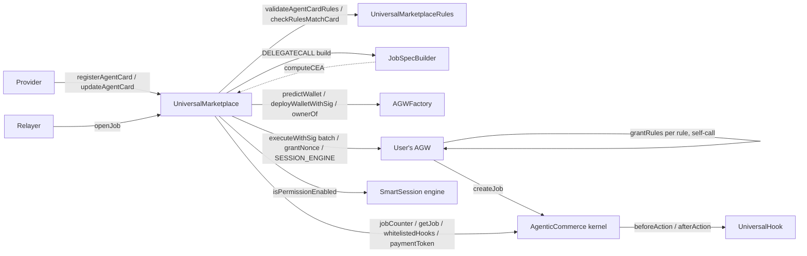
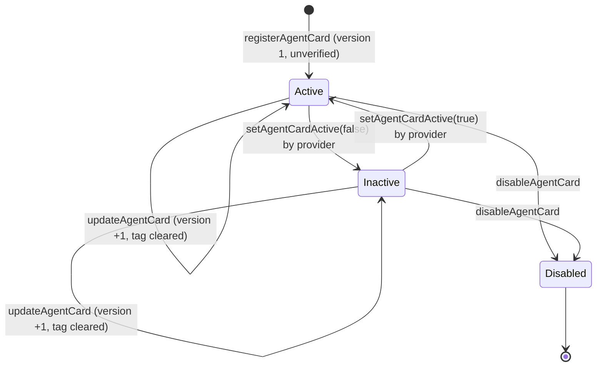

# Universal Marketplace

How the Universal Marketplace contracts work, end to end. Written for a reviewer: every guarantee is tied to the
code that enforces it, and every assumption the code makes about something else is stated.

| Doc | Contents |
|---|---|
| **This file** | What the marketplace is, its parts, the agent card lifecycle, `openJob` step by step, the rules check, the criteria, admin powers, upgradeability, trust model, limitations, tests, reviewer checklist |
| [`reference.md`](./reference.md) | Every function, event, error, registration reason, storage slot and constant, one by one |
| [`criteria.md`](./criteria.md) | The `JobSpec` format (the evaluator's), the `jobSpecTemplate` format, how a job's `JobSpec` is built, the rules the evaluator holds it to, and worked examples |
| [`../addresses/push_donut_universal_marketplace.md`](../addresses/push_donut_universal_marketplace.md) | The Push Donut deployment of 2.0.0 (to be replaced by a fresh 2.1.0 deployment): every proxy, implementation, ProxyAdmin, role and supported chain |

Code as of branch `sdk_iteration_v2` (marketplace 2.1.0: the job criteria aligned with the UniversalEvaluator, and
"one card" with one rule per destination chain). 2.1.0 ships as a **fresh deployment** on Push Donut, replacing the
2.0.0 deployment of 2026-10-20 (§12.5).

---

## Contract locations

| Contract | Path | Kind |
|---|---|---|
| **UniversalMarketplace** | [`src/agentic-commerce-8183/UniversalMarketplace.sol`](../../src/agentic-commerce-8183/UniversalMarketplace.sol) | Upgradeable (TransparentUpgradeableProxy), stateful. The only contract users and providers call. `version()` = `"2.1.0"`. |
| **UniversalMarketplaceRules** | [`src/agentic-commerce-8183/UniversalMarketplaceRules.sol`](../../src/agentic-commerce-8183/UniversalMarketplaceRules.sol) | Stateless, `pure`, not upgradeable. The rules side of a card: registration guards and rules = card at `openJob`. |
| **JobSpecBuilder** | [`src/agentic-commerce-8183/libraries/JobSpecBuilder.sol`](../../src/agentic-commerce-8183/libraries/JobSpecBuilder.sol) | External library, linked into the marketplace and called by `DELEGATECALL`. Builds each job's criteria. |
| Types | [`src/agentic-commerce-8183/libraries/Types.sol`](../../src/agentic-commerce-8183/libraries/Types.sol) | Every struct and enum of the package (file-level), the markers `MARKER_WALLET` / `MARKER_PRINCIPAL`, and `MAX_RULES`. |
| Errors | [`src/agentic-commerce-8183/libraries/Errors.sol`](../../src/agentic-commerce-8183/libraries/Errors.sol) | `UniversalMarketplaceErrors` (48 errors), `RulesBindingHookErrors`, `ERC8183HookErrors`. |
| JobSpecTypes | [`src/agentic-commerce-8183/libraries/JobSpecTypes.sol`](../../src/agentic-commerce-8183/libraries/JobSpecTypes.sol) | The built criteria (`JobSpec`): a byte-for-byte copy of the UniversalEvaluator's wire format at commit `8666c2a` (D1). |
| IUniversalMarketplace | [`src/agentic-commerce-8183/interfaces/IUniversalMarketplace.sol`](../../src/agentic-commerce-8183/interfaces/IUniversalMarketplace.sol) | The marketplace's events and functions (banners UM_1–UM_5). |
| IUniversalMarketplaceRules | [`src/agentic-commerce-8183/interfaces/IUniversalMarketplaceRules.sol`](../../src/agentic-commerce-8183/interfaces/IUniversalMarketplaceRules.sol) | The rules helper's two functions (banner UMR_1). |
| AGW interfaces | [`interfaces/external/IAGW.sol`](../../src/agentic-commerce-8183/interfaces/external/IAGW.sol), [`IAGWFactory.sol`](../../src/agentic-commerce-8183/interfaces/external/IAGWFactory.sol), [`ISmartSession.sol`](../../src/agentic-commerce-8183/interfaces/external/ISmartSession.sol) | The SmartSession `Session` mirror and the AGW / factory / engine functions the package calls (`grantRules`, `executeWithSig`, `grantNonce`, `SESSION_ENGINE`, …). AGW types are imported, not copied (§12.1). |

Contracts the marketplace works with, but which are **not** part of it:

| Contract | Where | Role |
|---|---|---|
| **AgenticCommerce** (the "kernel") | [`src/agentic-commerce-8183/AgenticCommerce.sol`](../../src/agentic-commerce-8183/AgenticCommerce.sol) | The ERC-8183 job kernel: jobs, budgets, escrow, payout. The marketplace only creates jobs on it (through the user's wallet). The Donut kernel on pUSDC (`0x977cf1AC973E9eC4332791d531507575006157Ed`) is kept for 2.1.0. |
| **UniversalHook, UniversalEvaluator** | evaluator branch `feat/universal-evaluator-pre-post-reads` at `8666c2a` (not in this package) | The 8183 hook and evaluator of the 2.1.0 deployment, deployed against the kernel (D4). At `fund` the hook validates the job's `JobSpec` with the evaluator's rules ([`criteria.md`](./criteria.md#what-the-evaluator-accepts)), freezes it and binds one rules set; the evaluator judges it after `submit`. |
| **RulesBindingHook** | [`src/agentic-commerce-8183/hooks/RulesBindingHook.sol`](../../src/agentic-commerce-8183/hooks/RulesBindingHook.sol) | The interim hook of the 2.0.0 deployment, and the hook of the unit and fork suites. At `fund` it binds the job to one live rules set and allows one live job per wallet. |
| **AGW + AGWFactory** | `push-agentic-wallets` repo (submodule [`lib/push-agentic-wallets`](../../lib/push-agentic-wallets)) | The user's agentic wallet (an ERC-7579 account with SmartSession) and its factory. Verifies the owner's signature. AGW v6 is deployed on Donut. |
| **UniversalRulesPolicy (URP)** | `push-agentic-wallets` repo | The SmartSession policy that enforces the agent's rules when the agent sends outbound calls through the gateway. |
| **CEAFactory** | destination chain (`src/cea/CEAFactory.sol` here) | Deploys each user's Chain Executor Account (CEA) on the destination chain. The marketplace only predicts CEA addresses. |

---

## 1 · What the marketplace is

The Universal Marketplace is a registry of **agent cards** plus one entry point, **`openJob`**.

- **An agent card** is a standing offer from one provider (an AI agent's address). Each provider has at most one
  card. It covers one job type. It says who the agent is, what it does, what it needs permission to do (the
  **rules**: one rule per EVM destination chain, up to `maxRulesPerCard`), and how "done" is judged (the
  **`jobSpecTemplate`**, the criteria template).
- **`openJob`** is one relayed call. On a single signature from the user, it:
  1. deploys the user's agentic wallet (AGW) if needed;
  2. grants the AGW every card rule, with the card's markers filled for this job (one rules set per destination
     chain), so the agent can act from it;
  3. creates an ERC-8183 job on the kernel, with the AGW as client, the card's provider as provider, the
     marketplace's configured evaluator and hook, and **criteria built on-chain from the card**.

  Steps 2 and 3 run as one owner-signed batch on the wallet.

What the marketplace deliberately does **not** do:

| Not done | Where it happens instead |
|---|---|
| Move any funds | The user funds the AGW in a separate transaction. The provider prices the job with `setBudget`; the AGW funds it with `fund`. Both are kernel calls. |
| Grant token approvals as the owner | Approvals are the agent's: an `approve` is an allowed call the agent makes, with its spender and amount pinned by the card (§6.1). |
| Judge whether the criteria make sense | Not on-chain in the marketplace (D5). The UniversalHook runs the evaluator's validation at `fund`; the admin's **verified tag** is the review. |
| Evaluate the job | The job's evaluator (the UniversalEvaluator). |
| Enforce the agent's rules at execution | The AGW's SmartSession engine and URP. |

The marketplace never holds tokens or native PC. Tests `test_MS02_movesNoFunds` and the invariants
`MI02_marketplaceHoldsNothing` and `MI05_userBalanceNeverMovedByOpenJob` check this.

---

## 2 · Glossary

| Term | Meaning |
|---|---|
| **Provider / agent** | One address. It registers the card, is the 8183 job's `provider` (and fee recipient), and is the agent the rules authorise (`sessionValidatorInitData == abi.encode(provider)`). One card per provider (`agentCardOf`). |
| **User / owner** | The person opening a job. Signs one `OwnerIntent`; owns the AGW. |
| **AGW** | Agentic Wallet: the user's smart account, deployed by the AGW factory at an address derived from `(owner, index)`. The job's client. |
| **CEA** | Chain Executor Account: the AGW's account on a destination chain, at an address derived from the AGW and the chain (`computeCEA`). It is where the agent's outbound calls execute and where the criteria read balances. One per chain. |
| **Agent card** | `AgentCard` (the listing) plus two blobs: `rules` and `jobSpecTemplate`. |
| **Rules** | On the card: `abi.encode(CardRule[])`, one `CardRule{chainNamespace, UniversalTerms terms}` per destination chain, with `terms.validUntil` and `terms.expectedCEA` blank. At `openJob`: one SmartSession `Session` per rule, granted to the agent, whose one policy carries the AGW v6 envelope `abi.encode(uint16 ENVELOPE_VERSION, string chain, bytes body)` with `UniversalTerms` as body. Each rules set's id (`rulesId`) is the engine's `permissionId`. |
| **`maxRulesPerCard`** | The admin's live cap on rules per card, 1 to `MAX_RULES` (4). Initialized to 1 (§13.4); 4 on Donut since 2026-10-31. |
| **Principal** | The amount the job is about. The **principal asset** is the one asset, across all of a card's rules, whose `maxTotal` is `MARKER_PRINCIPAL`. |
| **Pin** | An AGW v6 `ArgPin{offset, op, value}` on an allowed call: the calldata word at `offset` must equal (`EQ`) or not exceed (`MAX`) `value`. |
| **Markers** | Two published `bytes32` constants a card may hold where a per-job value goes: `MARKER_WALLET` (the user's CEA on that rule's chain, EQ pins only) and `MARKER_PRINCIPAL` (this job's principal, in pins and in the principal asset's caps). The signed sessions hold the filled values, never a marker (D2, D3). |
| **OwnerIntent** | The single owner-signed message (AGW type, imported). One signature authorises the wallet deploy and one batch execution: every rules grant, then `createJob`. |
| **`jobSpecTemplate`** | `abi.encode(JobSpecTemplate)`: the `JobSpec` with holes. Stored on the card. Also called the criteria template. |
| **JobSpec** | The built criteria for one job, in the evaluator's format: reads (each POST or PRE execution), checks (a `left` and a `right` side), the `logic` tree, `allowedMutability` (always `NONE`), `origin`. No timing. `abi.encode(JobSpec)` is the 8183 job's `description`. |
| **`logic`** | The job's pass logic: `Logic` entries, `COMPARE` leaves combined with `ALL`, `ANY` or `AT_LEAST k`. Copied verbatim; its semantics are evaluator-owned. |
| **Card version** | 1 at registration, +1 per update. Bound into every job's criteria, so an intent signed against one version can't open a job on another. Recorded per job (`cardVersionOfJob`). |
| **Verified tag** | An admin label: "this card, at this version, was reviewed". A tag, not a gate. |
| **chainHash** | `keccak256` of a CAIP-2 string such as `"eip155:11155111"`. The key for chain configuration. |
| **`PUSH_CHAIN_HASH`** | `keccak256("eip155:" ‖ block.chainid)`: Push Chain itself. No rule may name it. |

---

## 3 · The parts and how they fit



- **The marketplace** holds the cards and runs `openJob`. It is the `executor` named in the user's intent: the
  factory and the wallet accept that intent only from it.
- **The rules helper** is pure logic, split out for the EIP-170 size limit. It validates a card's rules at
  registration (U1–U4, R1–R17) and checks each signed session against its card rule at `openJob` (C0–C14).
- **JobSpecBuilder** is an external library. It turns the card's `jobSpecTemplate` plus the job's inputs into the
  job's `JobSpec`. It runs in the marketplace's context, so it reads CEAs from the marketplace's own `computeCEA`.
- **The AGW** does the work that needs the owner's authority: it verifies the owner's signature, runs the batch
  (granting each rule as a self-call, then calling `createJob` itself, so the kernel records the AGW as the
  client).

---

## 4 · The agent card

### 4.1 What a card holds

A card is three things stored on-chain together:

1. **`AgentCard`**, the listing. Who: `provider`. What: `jobType`, `metadataURI` and `metadataHash` (off-chain
   JSON with the name, summary, ABIs, criteria in words and param units). Commercials: `providerFee` (reference
   price, in `paymentToken`) and `paymentToken`. Job length: `minDuration` / `maxDuration`. And an `active`
   switch. The card has no chain of its own and no principal bounds: chains live in the rules, and any principal
   above zero is accepted.
2. **Rules**, `abi.encode(CardRule[])`: 1 to `maxRulesPerCard` rules, one per EVM destination chain. Each holds a
   full CAIP-2 `chainNamespace` and AGW v6 `UniversalTerms`: `assets` (1–8 `AssetCap{token, maxPerCall, maxTotal}`,
   each a PRC20 of that rule's chain), `maxGasPerCall` (PC wei per outbound) and `allowedCalls` (1–32 AGW
   `AllowedCall`s, with pins), with `validUntil` and `expectedCEA` left zero. Exactly one asset across all rules is
   the principal. See §6.
3. **`jobSpecTemplate`**, `abi.encode(JobSpecTemplate)`: see [`criteria.md`](./criteria.md).

`getAgentCard(cardId)` returns all three, the version and both tags in one call (`AgentCardView`). The
marketplace also stores each rule's chain hash (`_cardChainHashes`), for the CEA derivation at `openJob`.

**One card per provider.** `registerAgentCard` reverts `AgentCardAlreadyRegistered(provider)` if
`agentCardOf[msg.sender] != 0`. Disabling a card does not free the provider: a disabled provider cannot register
again (`test_MR11_onePerProvider`, invariant `MI06`).

**`paymentToken`.** Until the kernel supports a per-job payment token (K-12, out of scope), every job is paid in
the kernel's token, so a card must name exactly `KERNEL.paymentToken()` (`InvalidAgentCard("payment token")`,
`test_MR12_paymentTokenGuard`). `providerFee` is a reference price the client funds against; the marketplace does
not enforce it (§5).

### 4.2 What registration checks

`registerAgentCard` checks `agentCardOf` first; then it and `updateAgentCard` run `_validateCard`, in this order.
The first failure reverts.

| # | Check | Error |
|---|---|---|
| 1 | `jobType != 0` | `InvalidAgentCard("job type zero")` |
| 2 | `metadataURI` not empty | `InvalidAgentCard("metadata uri empty")` |
| 3 | `metadataHash != 0` | `InvalidAgentCard("metadata hash zero")` |
| 4 | `paymentToken == KERNEL.paymentToken()` | `InvalidAgentCard("payment token")` |
| 5 | the caller is not the marketplace's evaluator | `InvalidAgentCard("provider is evaluator")` |
| 6 | `1 hour ≤ minDuration ≤ maxDuration` | `InvalidAgentCard("duration range")` |
| 7 | the rules pass `RULES.validateAgentCardRules(rules, maxRulesPerCard)` (U1–U4, R1–R17, §6.2) | the helper's errors |
| 8 | **every** rule's chain is not Push and has a CEA deployment (`setCEADeployment`) | `ChainNotSupported(chainHash)` |
| 9 | **every** asset's `SOURCE_CHAIN_NAMESPACE()` is a well-formed string equal to **its rule's** chain | `InvalidAgentCard("asset")` / `InvalidAgentCard("asset chain")` |

**The `jobSpecTemplate` is stored as given; it is not checked.** Whether the evaluator can run it is the
provider's responsibility. A malformed template fails only when a job is built from it (§7.3), and one the
evaluator would refuse fails only at `fund`.

Checks 8 and 9 run per rule in the marketplace because they need its storage (`test_MR15_multiRuleCards`: Push or
an unconfigured chain in rule 2, an asset from the wrong chain in rule 2). Check 9 uses a raw `staticcall` plus an
ABI-shape check, not `try/catch`: a `try` clause cannot catch the decoding of its own return data, so a non-string
answer would otherwise revert with an opaque error. A codeless asset answers empty and fails the length check
(`test_MR06_assetTeeth`, `test_MR13_everyAssetOnChain`).

### 4.3 Lifecycle



| Action | Who | Effect |
|---|---|---|
| `registerAgentCard` | any address without a card (becomes the provider) | Stores the card, version 1, active, unverified; `agentCardOf[provider] = cardId`. The contract writes `provider = msg.sender` and `active = true`, ignoring the caller's values. |
| `updateAgentCard` | the provider | Replaces every field except `provider` and `active` (so `jobType`, `metadataURI`, `metadataHash`, `providerFee`, `paymentToken`, durations), both blobs and the stored chain hashes. Version +1, verified tag cleared. **The chains may change** (`test_ML09_update_mayMoveChains`). Validated like a registration, against the current `maxRulesPerCard`. Refused for a disabled card (`AgentCardDisabled`). |
| `setAgentCardActive` | the provider | Switches the card on or off. A disabled card cannot be switched back on. |
| `verifyAgentCard(cardId, cardVersion)` | admin | Sets the verified tag. `cardVersion` must be the current version (`AgentCardVersionMismatch`), so a provider who updates after review makes it revert. Refused for a disabled card; allowed for an inactive one. |
| `revokeAgentCardVerification` | admin | Clears the tag. Idempotent: emits only if there was a tag. |
| `disableAgentCard` | admin | Permanent kill switch: disabled, inactive, tag cleared. The provider cannot undo it, and keeps its `agentCardOf` entry. |

**Updates and signed intents.** The card version is hashed into every job's `origin`, which is inside the
`createJob` call of the batch the owner signs. After an update, an intent signed against the old version fails at
`AgentCardVersionMismatch` (stale `p.cardVersion`) or at `IntentExecMismatch` (current version, old intent)
(`test_ML11_update_invalidatesOldIntents`). A provider therefore cannot swap the card, its chains included, under
a user's signature. Jobs already opened are untouched (`test_ML12_update_leavesOpenedJobsUntouched`).

**The verified tag is a tag, not a gate.** `openJob` treats verified and unverified cards alike. The SDK shows it.

---

## 5 · End-to-end flow

```mermaid
sequenceDiagram
    autonumber
    actor P as Provider (agent)
    actor U as User (owner)
    participant SDK
    participant M as UniversalMarketplace
    participant F as AGWFactory
    participant W as User's AGW
    participant K as Kernel (AgenticCommerce)
    participant H as UniversalHook

    P->>M: registerAgentCard(card, rules, jobSpecTemplate)
    U->>SDK: pick a card, principal, duration, params
    SDK->>SDK: expiredAt = now + duration; one session per card rule, markers filled
    SDK->>M: previewIntent(request, sessions)
    M-->>SDK: OwnerIntent (batch hash binds every grant and the built criteria)
    U->>SDK: sign the OwnerIntent once
    SDK->>M: openJob(params) via a relayer
    M->>F: deployWalletWithSig(intent, sig, label) [if new]
    M->>W: executeWithSig(MODE_BATCH, batch, intent, sig)
    W->>W: grantRules(session i), for each card rule
    W->>K: createJob(provider, evaluator, expiredAt, JobSpec, hook)
    M->>M: every rulesId enabled on the engine
    Note over M,K: job is Open, budget 0. Nothing has moved.
    U->>W: funding tx (SDK-built): principal, PC for gas, fee
    P->>K: setBudget(jobId, card.providerFee)
    W->>K: fund(jobId, card.providerFee, optParams)
    K->>H: beforeAction(fund): validate and freeze the JobSpec, bind rulesIds[0]
    P->>W: act within the rules (URP-enforced outbound calls, approvals included)
    P->>K: submit; the evaluator judges the JobSpec
```

1. **The provider registers a card** (§4).
2. **The user opens a job.** The SDK derives `expiredAt` from the user's duration, builds one session per card
   rule (filling the markers), calls `previewIntent`, the user signs the returned `OwnerIntent` once, and a relayer
   calls `openJob`. The AGW is deployed (if new), granted every rule, and creates the job in **Open** with budget 0.
3. **The user funds** the AGW, in one transaction built by the SDK: the principal (in the principal asset), PC
   for gas and the fee.
4. **The provider prices** the job: `kernel.setBudget(jobId, card.providerFee)`.
5. **The AGW funds** the job: `kernel.fund(jobId, card.providerFee, optParams)`. With the UniversalHook (from the
   evaluator branch), the evaluator is prefunded first and `optParams = abi.encode(rulesIds[0], keccak256(description), bytes(""))`;
   the hook validates the description with the evaluator's rules ([`criteria.md`](./criteria.md#what-the-evaluator-accepts)),
   freezes it and binds the rules set. With RulesBindingHook, `optParams = abi.encode(rulesId)`. Either way one
   rules set is bound per job, which is why cards have one rule for now (§13.4). A provider who prices above the
   card's fee cannot be funded, because the owner's `expectedBudget` is the card fee (`BudgetMismatch`;
   `test_MS17_8183Continuation_feeEnforcedAtFund`).
6. **The agent executes** within the rules (including any pinned `approve`), submits, and the evaluator judges
   the criteria (kernel).

Steps 3–6 are outside the marketplace. They are shown because the marketplace's design depends on them. The fork
test `test_fork_openJob_realAGWv6` runs steps 2, 4 and 5 against the real AGW v6 on Donut, with RulesBindingHook.

---

## 6 · The rules: rules = card

The owner signs SmartSession `Session`s the SDK builds, which they cannot read. The marketplace proves each one is
exactly its card rule, with the card's markers filled for this job, for the card's agent, bound to this job and
to the AGW's CEA on that rule's chain. Both checks live in the rules helper.

### 6.1 The format (AGW v6)

The card stores `CardRule[]`, one per destination chain:

```solidity
struct CardRule {
    string chainNamespace;  // full CAIP-2, "eip155:<id>", never Push; no two rules share one
    UniversalTerms terms;   // AGW v6: validUntil (0), expectedCEA (0), assets, maxGasPerCall, allowedCalls
}
```

`UniversalTerms`, `AssetCap`, `AllowedCall`, `ArgPin` and `PinOp` are the AGW v6 types, imported from
`@push-agw/libraries/Types.sol`; `CardRule` is the package's own (D7). Per job, session `i` carries one URP policy
whose `initData` is the v6 **envelope** `abi.encode(uint16 version, string chainNamespace, bytes body)`, with
`version == ENVELOPE_VERSION` (1), `chainNamespace` = rule `i`'s chain, and `body = abi.encode(UniversalTerms)`:
rule `i`'s terms with `validUntil = expiredAt`, `expectedCEA` = the AGW's CEA on that chain, and the markers filled.

**Multi-chain.** Each rule is its own rules set on its own chain, granted in the same batch. `MARKER_WALLET` in
rule `i` means the CEA on rule `i`'s chain, so funds the agent moves on Base stay with the user's Base CEA.

**Multi-asset.** Each asset has its own `maxPerCall` and lifetime `maxTotal`. The principal asset's caps are set
per job (D3); every other asset's caps are copied from the card. A second asset with caps `{0, 0}` may route a
request but never moves (the two-asset fixture `_rulesTwoAssets`).

**The principal.** Exactly one asset across all rules has `maxTotal == MARKER_PRINCIPAL`; that asset, in whichever
rule holds it, is the principal. Its home chain is its rule's chain (the asset-chain check). There is no
`principalAsset` index and no principal range on the card; `openJob` refuses a principal of zero (D14).

**Markers** (D2, D3). Where a card needs a per-job value it holds a marker, and the signed session holds the
value the marketplace fills in:

| Card holds | Where | The signed session must hold |
|---|---|---|
| `MARKER_PRINCIPAL` | the principal asset's `maxTotal` (as `uint256`) | `principal` |
| `MARKER_PRINCIPAL` | the principal asset's `maxPerCall` | `principal` |
| a number `n` | the principal asset's `maxPerCall` | `n` (a "tranche" card, `test_MS20_openJob_trancheCard`) |
| a number | any field of any other asset | the same number |
| `MARKER_WALLET` | a pin's `value` (op EQ) in rule `i` | `bytes32(uint256(uint160(computeCEA(agw, chainHash_i))))` |
| `MARKER_PRINCIPAL` | a pin's `value` (op EQ or MAX) | `bytes32(principal)` |
| any other `bytes32` | a pin's `value` | the same value |

`MARKER_WALLET = keccak256("push.marketplace.marker.WALLET")` and
`MARKER_PRINCIPAL = keccak256("push.marketplace.marker.PRINCIPAL")`. Both have non-zero high 96 bits, so neither
is a clean address word (`test_naming_markers`).

**Approvals and transfers are allowed calls under strict rules** (D11). There is no owner-approval list. The
helper keeps stricter ERC-20 rules than the one-card proposal (which allows `increaseAllowance` and any pinned
`transfer` recipient):
- `increaseAllowance` is refused: repeated calls could build an unbounded allowance;
- `approve` needs the spender pinned EQ to a fixed address **and** the amount capped by a `MAX` pin (a literal or
  `MARKER_PRINCIPAL`);
- `transfer` / `transferFrom` must send to the user's own account: the beneficiary field at the recipient
  offset, or an EQ `MARKER_WALLET` pin there. A provider-written card cannot send the user's funds to an address
  the provider picks.

Several entries may share one `(target, selector)` with different pins ("approve to Aave or to Uniswap"), but only
if every one of them is pinned.

### 6.2 At registration: `validateAgentCardRules`

Decodes `CardRule[]` (malformed bytes revert in `abi.decode` without data), then checks in this order; the first
failure reverts. Within a rule, each check runs over every item before the next check starts.

| # | Check | Error |
|---|---|---|
| U1 | `1 ≤ rules ≤ maxRulesPerCard` | `RulesEmpty()` · `TooManyRules(n, max)` |
| | **per rule `i`:** | |
| U2 | `chainNamespace` starts with `"eip155:"` and is longer than 7 bytes | `InvalidAgentCard("chain namespace")` |
| U3 | no earlier rule names the same chain | `DuplicateChain(i)` |
| U4 | `terms.validUntil == 0` and `terms.expectedCEA == 0` | `RuleHasAgent(i)` |
| R1 | `1 ≤ assets ≤ MAX_ASSETS` (8) | `InvalidAgentCard("asset count")` |
| R3 | every asset's `token != address(0)` | `InvalidAgentCard("asset zero")` |
| R4 | no two assets of the rule share a token | `InvalidAgentCard("duplicate asset")` |
| R8 | `1 ≤ allowedCalls ≤ 32` | `InvalidAgentCard("allow-list size")` |
| R9 | `pins ≤ MAX_PINS` (8) per call, and `≤ MAX_ALLOWED_CALL_PINS` (32) in the rule | `InvalidAgentCard("too many pins")` |
| R10 | a pin holding `MARKER_WALLET` has `op == EQ` | `InvalidAgentCard("wallet marker op")` |
| R11 | no two calls are byte-identical | `InvalidAgentCard("duplicate call")` |
| R12 | two calls with the same `(target, selector)` are both pinned | `InvalidAgentCard("unpinned duplicate")` |
| R13 | no `increaseAllowance` | `InvalidAgentCard("increaseAllowance")` |
| R14 | `approve` has a pin `{4, EQ, v}`, `v` a non-zero clean address word (so never a marker) | `UnpinnedApprove(i, call)` |
| R15 | `approve` has a pin `{36, MAX, *}` | `InvalidAgentCard("approve amount not capped")` |
| R16 | `transfer` binds its recipient to the user's account: beneficiary at 4, or a pin `{4, EQ, MARKER_WALLET}` | `UnpinnedTransfer(i, call)` |
| R17 | `transferFrom` likewise at offset 36 | `UnpinnedTransfer(i, call)` |
| | **across all rules:** | |
| R6 | the principal asset's `maxPerCall != 0` | `InvalidAgentCard("principal per-call zero")` |
| R7 | no other asset holds `MARKER_PRINCIPAL` as `maxPerCall` | `InvalidAgentCard("marker off principal asset")` |
| R5 | exactly one asset has `maxTotal == MARKER_PRINCIPAL` | `NoPrincipal()` · `ManyPrincipals()` |

It returns each rule's chain hash, and every asset with the chain hash of its rule, which the marketplace then
checks (§4.2, checks 8 and 9). The full table is in [`reference.md`](./reference.md#universalmarketplacerules).

### 6.3 At `openJob`: `checkRulesMatchCard`

One session per card rule, same order. In order; the first mismatch reverts, and every per-pair error names the
rule `i` first.

| # | The session must… | Error |
|---|---|---|
| C0 | (count) be one per card rule | `SessionCountMismatch(expected, actual)` |
| C1 | name the card's provider as its agent: `sessionValidatorInitData == abi.encode(provider)` | `AgentMismatch(i)` |
| C2 | have exactly one action | `ActionCount(i)` |
| C3 | with exactly one policy | `PolicyShape(i)` |
| C4 | whose `initData` starts with the word `ENVELOPE_VERSION`, read **before** any decode (0 if under 32 bytes) | `EnvelopeVersionMismatch(i, actual)` |
| C5 | and names rule `i`'s chain | `ChainMismatch(i)` |
| C6 | carry as many assets as the rule | `AssetCountMismatch(i, expected, actual)` |
| C7 | with the rule's tokens, in order | `AssetMismatch(i, j)` |
| C8 | with the principal asset's `maxTotal == principal`, and `maxPerCall == principal` (marker) or the card's number | `AssetMismatch(i, j)` |
| C9 | and every other asset's caps exactly the card's | `AssetMismatch(i, j)` |
| C10 | and the rule's `maxGasPerCall` | `GasCapMismatch(i)` |
| C11 | and the rule's allowed calls: same count, same target, selector, beneficiary fields, `maxValue`, pin count, and each pin's offset and op | `ActionsMismatch(i)` |
| C12 | with each pin's value equal to the card's, markers filled (table in §6.1) | `PinMismatch(i, call, pin)` |
| C13 | expiring with the job: `validUntil == expiredAt` | `ExpiryMismatch(i)` |
| C14 | paying only the AGW's own CEA on that chain: `expectedCEA == computeCEA(agw, chainHash_i)` | `ExpectedCEAMismatch(i, expected, actual)` |

C4 mirrors URP: a pre-v6 two-field envelope `(string, bytes)` has first word 64 (the string's offset), so it is
named `EnvelopeVersionMismatch(0, 64)` instead of panicking the decoder (`test_MS22_envelopeVersion_named`). C11
and C12 share one loop, per call and then per pin. A mismatch in the second rule names index 1
(`test_MT16_matchPerPair`, `test_MS24_multiRule_sessionErrors`: the Base session carrying the Sepolia CEA fails
`PinMismatch(1, 0, 0)`).

The session never carries a marker: C8 and C12 compare against the filled value, so a session holding the raw
marker fails (`test_MT09_match_pins`). D3 makes the principal caps exact: a per-call cap below the principal is
refused (`test_MB04_perCallMustEqualPrincipal`); the invariant `MI07` checks every granted principal `maxTotal`
equals the job's principal.

What C12 and C14 protect: the `MARKER_WALLET` pins and URP's beneficiary pins bind funds the agent moves to the
user's own CEA on each chain. The marketplace derives each CEA itself (§9); the SDK derives it independently from
the destination `CEAFactory`. A disagreement fails closed before anything happens.

Fields the helper does not compare, and why that is safe, are in §13.2.

---

## 7 · The criteria: card ⊆ job

### 7.1 Why they are built on-chain

If the SDK or relayer supplied the job's criteria, nothing would guarantee they are the card's: a relayer could
swap in easier ones. Instead, `openJob` builds the criteria from the card's **stored** `jobSpecTemplate` and the
job's inputs. The result goes into the `createJob` call of the batch, which the owner's intent hashes
(`execCalldataHash`). So the owner's single signature covers the exact criteria, and the marketplace re-derives
them before executing.

### 7.2 What building does

`JobSpecBuilder.build(jobSpecTemplate, ctx)` fills the template's holes:

| Hole | Filled with |
|---|---|
| a `Fill` with source `CEA` in a read's args | the AGW's CEA **on that read's chain** (PRE and POST reads alike) |
| a `Fill` with source `PARAM` | one of the job's `params` (two's complement for negatives) |
| a check target `FIXED` | the template's value |
| a check target `PRINCIPAL_BPS` | `principal × bps / 10 000`, rounded down |
| a check target `PARAM` | one of the job's `params` |
| a check target `CEA` | the AGW's CEA on the chain of the check's `left[0]` read |
| `allowedMutability` | always `NONE` |
| `origin` | `keccak256(abi.encode(marketplace, cardId, cardVersion, principal))` |

`logic`, every check's `left` / `right`, every read's `at` and every other read field are copied verbatim. There
is no timing in the criteria (D3). The full format and the worked examples are in [`criteria.md`](./criteria.md).

### 7.3 What building checks, and what it doesn't

The template is **not judged** by the marketplace (D5). Building checks only what building needs:

| Check | Error |
|---|---|
| one param per template param | `ParamCountMismatch(expected, actual)` |
| each param inside its inclusive bounds | `ParamOutOfRange(index, value)` |
| each fill writes inside its read's args | `FillOutOfBounds(read, fill)` |
| `principal × bps` fits in uint256 | `TargetOverflow(check)` |
| a CEA is asked only for a chain with a CEA deployment | `ChainNotSupported(chainHash)` |

Anything else malformed reverts on its own when a job is built (an index out of range panics, undecodable bytes
fail in `abi.decode`). A template the evaluator could not run, such as a read no check uses or no POST read,
**builds without complaint** (`test_JB08_doesNotJudgeTheTemplate`, `test_MC07_badTemplateFailsEvaluatorValidate`).
The evaluator's rules are applied by the UniversalHook at `fund`, so such a job opens but can never be funded.
Tests hold every built example to a copy of the evaluator's validation (`test_MC06_builtSpecsPassEvaluatorValidate`);
the SDK gets the rule list ([`criteria.md`](./criteria.md#what-the-evaluator-accepts)). The verified tag is the
review.

---

## 8 · `openJob`, step by step

`openJob(OpenJobParams p) returns (uint256 jobId, address agw, bytes32[] rulesIds)` is `whenNotPaused` and
`nonReentrant`. **Every check runs before the first state change**, so a refusal leaves no wallet, no grant and no
job (`test_MS13_intentSessionMismatch_noStateOnFailure`, `test_MS22_envelopeVersion_named`,
`test_MS24_multiRule_sessionErrors`). The numbering follows the code's NatSpec.

| Step | What | Code | Error on failure |
|---|---|---|---|
| 1 | Card exists and is active, and `p.cardVersion` is its current version | `_checkCardAndJob` | `AgentCardInactive()` · `AgentCardVersionMismatch(provided, current)` |
| 2 | `principal != 0` | `_checkCardAndJob` | `ZeroPrincipal()` |
| 3 | `now + minDuration ≤ expiredAt ≤ now + maxDuration` | `_checkCardAndJob` | `ExpiryOutOfRange()` |
| 4 | the card's provider is not the current evaluator (it may have changed since registration) | `_checkCardAndJob` | `ProviderIsEvaluator()` |
| 5 | `(agw, deployed) = AGW_FACTORY.predictWallet(intent.owner, intent.index)`; the intent names that wallet and this marketplace as executor | `_resolveWallet` | `IntentWalletMismatch(expected, provided)` · `ExecutorMismatch(expected, actual)` |
| 6 | the AGW has no active job opened here: `activeJobOf(agw) == 0` | `openJob` | `WalletHasActiveJob(agw, jobId)` |
| 7 | build the batch: the job's criteria from the card's `jobSpecTemplate`, then `[ (agw, 0, grantRules(sessions[0])) … (agw, 0, grantRules(sessions[n−1])), (kernel, 0, createJob(provider, evaluator, expiredAt, description, hook)) ]`, `abi.encode`d as ERC-7579 batch calldata | `_buildBatch` → `JobSpecBuilder.build` | §7.3 errors |
| 8 | the intent's `mode` is `MODE_BATCH`, its `execCalldataHash` is this batch's hash and its `nonceKey` is `OPENJOB_LANE`; its `sessionHash` is 0 (no grant-door session) | `_bindIntent` | `IntentExecMismatch(batchHash)` · `IntentSessionMismatch(0)` |
| 9 | each session is its card rule with markers filled, `SessionContext{agent: provider, principal, expiredAt, expectedCEAs[i] = computeCEA(agw, chainHash_i)}`, the chain hashes stored at registration (§6.3) | `_checkRules` → `RULES.checkRulesMatchCard` | C0–C14 errors; `ChainNotSupported` if a rule's chain was cleared since |
| — | `g = deployed ? AGW.grantNonce() : 0` | `openJob` | — |
| — | *first state change* | | |
| 10 | deploy the predicted wallet (`deployWalletWithSig`) and require it landed at the prediction; or, for an existing wallet, require the factory's `ownerOf` is the intent's owner | `_deployOrCheckOwner` | `AGWMismatch(expected, actual)` · `WalletOwnerMismatch(expected, actual)` |
| 11 | `AGW.executeWithSig(MODE_BATCH, batch, intent, sig)`: the wallet self-calls `grantRules` per rule, then calls `createJob`; exactly one new kernel job, whose client is the AGW and whose provider, hook and evaluator are the expected ones | `_createJob` | the AGW's own errors · `UnexpectedJobCount(before, after)` · `JobMismatch()` |
| 12 | `rulesIds[i] = keccak256(abi.encode(sessions[i].sessionValidator, sessions[i].sessionValidatorInitData, bytes32(g + i)))`, each enabled: `ISmartSession(AGW.SESSION_ENGINE()).isPermissionEnabled(rulesIds[i], agw)` | `_grantedRulesIds` | `RulesNotGranted(i)` |
| 13 | record `_lastJobOf`, `cardOfJob`, `agwOfJob`, `_rulesOfJob`, `cardVersionOfJob`; emit `JobOpened(cardId, owner, agw, jobId, rulesIds, principal, cardVersion)` | `openJob` | — |

**Why binding comes before rules = card.** Every signed input (sessions, principal, expiry, params, card version,
the wallet through its CEA) is inside the batch. Binding first names a tampered input as unsigned
(`IntentExecMismatch`), rather than as a rules mismatch.

**One signature for any number of rules** (D12). The AGW lets an owner-signed `executeWithSig` batch self-call its
`onlyOwnerOrSelf` functions, so `grantRules` runs under the owner's authority inside the batch. The intent asks for
no grant through the grant door, so its `sessionHash` is 0. `openJob` makes exactly one owner execution
(`test_MS23_multiRule_freshAndExisting`: two grants, one nonce).

**The rules ids** (D13). The AGW overwrites each session's salt with its grant counter before enabling it, and
SmartSession's id is `keccak256(abi.encode(validator, validatorInitData, salt))` (`IdLib.toPermissionId`). So grant
`i` of the batch has salt `g + i`, where `g` is the wallet's `grantNonce()` before the batch (0 for a new wallet).
Step 12 re-checks every id against the engine, so a drift in either formula fails closed (`test_MS25_rulesNotGranted`).
`test_MS23` checks the ids on a fresh and an existing wallet (salts continue from the live grant nonce); the fork
test checks them on the real engine.

**What one signature binds.** The owner signs one `OwnerIntent`. Through it:

| Bound value | How |
|---|---|
| principal, params, card version, the wallet (through its CEA) | inside the built `JobSpec`, inside the `createJob` call → `execCalldataHash` |
| `expiredAt`, provider, evaluator, hook | `createJob` arguments → `execCalldataHash` |
| every rule (assets and caps, gas cap, calls and pins, CEA, expiry, chain) | the `grantRules(session)` calls of the batch → `execCalldataHash` |
| which wallet, which executor | `wallet`, `executor` fields |
| replay | `nonceKey` / `nonceSeq` (the owner lane), checked by the AGW |

`test_MS12_intentExecMismatch_everyBoundInput` changes each bound input in turn and expects `IntentExecMismatch`.

**Who checks the signature.** Not the marketplace. The factory and the wallet verify the owner's signature
themselves and accept the intent only from its `executor` (this contract). The marketplace's own checks
(steps 5 and 8) mirror the wallet's, so a mismatch fails early with a named error before any state change.

**Previewing.** `previewIntent(request, sessions)` returns the exact `OwnerIntent` to sign: it predicts the wallet,
builds the same batch `openJob` will, hashes it, sets `mode = MODE_BATCH` and `sessionHash = 0`, and reads the
wallet's live nonces (0 for a wallet not yet deployed). `buildCreateJobCalldata(cardId, owner, index, job, sessions)`
returns `(MODE_BATCH, batch)` itself. Both revert `AgentCardInactive` for an unknown card, and both revert exactly
as step 7 would on a bad template. `test_MV04_buildCreateJobCalldata` asserts that what `openJob` executes equals
this view's answer.

**Front-running.** `openJob` can be called by anyone holding the signed parameters; the relayer has no power. A
third party who submits them first opens exactly the job the owner signed. The AGW's nonces make it one-shot.

---

## 9 · Chains and CEAs

A rule's chain must be configured before any card can name it:

- **`setCEADeployment(chainHash, ceaFactory, ceaProxyImpl)`** (admin) records the destination chain's CEA factory
  and proxy implementation. A chain without one cannot carry card rules (`ChainNotSupported`), and the builder
  cannot ask for a CEA on it.
- **Clearing a chain.** `setCEADeployment(chainHash, 0, 0)` deletes the entry and emits
  `CEADeploymentSet(chainHash, 0, 0)`. Registration and update naming that chain, `computeCEA`, and `openJob` on an
  existing card with a rule there then revert `ChainNotSupported(chainHash)`. Exactly one zero address reverts
  `ZeroAddress()` (`test_MV11_setCEADeployment_clear`).
- **`computeCEA(agw, chainHash)`** mirrors `CEAFactory._computeCEAInternal`: an OZ minimal proxy of
  `ceaProxyImpl`, salt `keccak256(abi.encode(agw))`, deployed by the CEA factory (`test_MV02_computeCEA` checks it
  against the real `CEAFactory`). `openJob` computes one per card rule, from the chain hashes stored with the card.
- **Push itself is never a rule's chain** (`PUSH_CHAIN_HASH`, set at `initialize` from `block.chainid`).

There is **no per-chain pause** (the 2.0.0 `setUniversalPaused` / `isUniversalPaused` pair is gone;
`test_MV14_noPerChainPause`).

**CEA implementation rotation.** If a destination rotates its CEA proxy implementation, `computeCEA` goes stale.
An SDK reading the destination factory then signs the new CEA (in the `MARKER_WALLET` pin and `expectedCEA`), and
`openJob` refuses it, first at the wallet pin (`PinMismatch(0, 1, 0)` in the test fixture), until the admin
updates the deployment (`test_MV03_ceaRotation_staleCaught`). Runbook:

1. `pause()` stops registration, updates and `openJob` marketplace-wide.
2. Rotate the implementation on the destination chain.
3. `setCEADeployment(chainHash, factory, newImpl)`.
4. `unpause()`.

An intent signed before the rotation names the old CEA in its batch, so after step 3 it fails
`IntentExecMismatch` and must be re-signed. The CEA value is security-relevant: it is the wallet pin and expected
CEA of every rules grant on that chain (§6.3 C12, C14). A wrong entry still cannot silently redirect funds,
because the SDK derives the CEA independently and the two must agree.

---

## 10 · One live job per wallet

Two rules, at two moments, read through two views named `activeJobOf`:

| View | Where | Returns the job id while | Used by |
|---|---|---|---|
| `UniversalMarketplace.activeJobOf(agw)` | marketplace | the last job **opened here** for the AGW is Funded, Submitted, or Open and not yet expired; else 0 | `openJob` step 6 (`WalletHasActiveJob(agw, jobId)`) |
| `RulesBindingHook.activeJobOf(agw)` | hook | the AGW's last job **bound by the hook** is Funded or Submitted; else 0 | `fund` (`AGWHasLiveJob(agw, jobId)`) |

The table shows RulesBindingHook; the UniversalHook applies its own rule at `fund`. The difference is intended:
the marketplace binds at `openJob`, so an Open, unexpired job also blocks and a user cannot stack unfunded jobs on
one wallet; the hook binds at `fund`, so it only sees funded jobs. An Open job frees the wallet once it expires or
is rejected; a Funded or Submitted job frees it once it is completed, rejected or refunded
(`test_MS14_oneLiveJob`, `test_MS21_activeJobOf`, hook `test_activeJobOf_returnsId`).

Jobs created directly on the kernel, not through the marketplace, are invisible to the marketplace's
`activeJobOf`. The hook's rule still covers any job that names the hook.

---

## 11 · Admin powers

Roles (OpenZeppelin AccessControl): `DEFAULT_ADMIN_ROLE` manages roles; `ADMIN_ROLE` runs every admin function.
Both go to `InitParams.admin`. Upgrades are separate: they belong to the ProxyAdmin owner.

| Function | Effect | Limits |
|---|---|---|
| `setHook(hook)` | hook of every **new** job | must be non-zero and whitelisted on the kernel; existing jobs keep theirs |
| `setEvaluator(evaluator)` | evaluator of every **new** job | non-zero; a card whose provider is the new evaluator can't open jobs (`ProviderIsEvaluator`) |
| `setCEADeployment(chainHash, factory, impl)` | enables a chain and sets its CEA derivation, or clears it with `(h, 0, 0)` | exactly one zero reverts |
| `setMaxRulesPerCard(n)` | the live cap on rules per card | `1 ≤ n ≤ MAX_RULES` (4), else `InvalidMaxRules(n)`; applies at register and update only, so lowering it leaves registered cards alone (`test_MR16_setMaxRulesPerCard`) |
| `setAgentRating(agent, rating)` | sets an agent's rating, read by `getAgentRating` | no validation; a placeholder until VerifiedRatings is wired |
| `pause()` / `unpause()` | stops or resumes `registerAgentCard`, `updateAgentCard`, `openJob` | admin functions, `setAgentCardActive` and views stay live |
| `disableAgentCard(cardId)` | permanently disables a card | cannot re-enable; the provider stays registered |
| `verifyAgentCard(cardId, cardVersion)` / `revokeAgentCardVerification(cardId)` | the verified tag | version-bound |

The admin cannot move funds (the marketplace holds none), cannot change an opened job (the kernel fixed its
provider, evaluator, hook and description at creation), and cannot re-enable a disabled card.

The admin **can** influence future jobs: the evaluator decides completion, and the hook gates funding. Both are
trust points of the deployment. Raising `maxRulesPerCard` above 1 before the hook binds every rules set of a job
would let multi-rule cards open jobs whose extra rules sets the hook never binds (§13.4). On Donut it was raised to 4
on 2026-10-31 for multi-chain cards, accepting this.

---

## 12 · Deployment, upgradeability and build

### 12.1 AGW dependency

The package compiles against AGW v6 source: the submodule [`lib/push-agentic-wallets`](../../lib/push-agentic-wallets),
pinned at commit `ffd567d3e49b2d27c6f50ad36093274dbac3090f` (branch `deploy-agw`), with the remapping
`@push-agw/=lib/push-agentic-wallets/src/`. AGW v6 on Donut was deployed from that same commit. This iteration
does not change the AGW.

- Imported by name from `@push-agw/libraries/Types.sol` (a file with no imports): `OwnerIntent`,
  `OWNER_LANE_FLAG`, `AssetCap`, `AllowedCall`, `ArgPin`, `PinOp`, `UniversalTerms`, `ENVELOPE_VERSION`,
  `MAX_ASSETS`, `MAX_PINS`, `MAX_ALLOWED_CALL_PINS`; `Execution` from `@push-agw/libraries/ExecutionLib.sol`; the
  fork test also imports the EIP-712 constants and `SEND_OUTBOUND_SELECTOR`. A struct change in the AGW fails this
  build, not `openJob`.
- `Session` and its parts stay a mirror in `IAGW.sol` (the vendor SmartSession tree cannot be compiled here). The
  fork test pins it: a wrong mirror changes the batch the owner signs and the real wallet refuses it.
- Donut v6 addresses are deploy-time inputs and test constants; nothing in `src/` hard-codes them.

### 12.2 Wiring

1. A kernel with a UniversalHook and UniversalEvaluator deployed against it, and the hook whitelisted on the
   kernel (`setHookWhitelist(hook, true)`). The evaluator team deploys and owns these (D4); on Donut they are
   listed in §12.5.
2. Deploy `UniversalMarketplaceRules` (no constructor arguments).
3. Deploy the `JobSpecBuilder` library and link it into `UniversalMarketplace`. Foundry links it automatically in
   tests and scripts.
4. Deploy the `UniversalMarketplace` implementation; its constructor disables initializers.
5. Deploy a `TransparentUpgradeableProxy` calling `initialize(InitParams{agwFactory, kernel, hook, evaluator,
   rules, admin})` with the UniversalHook and UniversalEvaluator. Every address must be non-zero, and the hook
   must be whitelisted on the kernel. `maxRulesPerCard` starts at 1.
6. `setCEADeployment` for each supported destination chain.

RulesBindingHook remains a valid hook for this marketplace: it binds one rules set per job, as the UniversalHook
does, but it does not validate or freeze the `JobSpec`.

### 12.3 Upgradeability

- **The marketplace** sits behind a `TransparentUpgradeableProxy`. 2.1.0 is a **fresh proxy**, not an upgrade of
  2.0.0 (D6): `AgentCard` changed shape and the reserved slot 14 of 2.0.0 was dropped. Its layout is slots 0–22,
  then a 27-slot gap, 23–49 (see [`reference.md`](./reference.md#storage-layout)). OZ upgradeable bases use
  ERC-7201 namespaced storage, so they don't occupy these slots. `test_MV09_storageLayout_bySlot` pins every slot
  by position, and `test_MV10_upgrade_preservesState` upgrades through the ProxyAdmin and checks every view.
  Every upgrade of the 2.1.0 proxy must keep this layout.
- **The rules helper and JobSpecBuilder** are not upgradeable. A rule change is a new deployment plus a
  marketplace upgrade that points at it. The helper is an `initialize`-time address (`RULES`); the library's
  address is linked into the implementation's bytecode.

### 12.4 Deploy script

[`scripts/agentic-commerce-8183/DeployUniversalMarketplace.s.sol`](../../scripts/agentic-commerce-8183/DeployUniversalMarketplace.s.sol)
deploys a fresh 2.1.0 marketplace on the existing kernel and follows §12.2 steps 2–6. It deploys no kernel and no
hook:

1. Reads the kernel (env `KERNEL`, default the evaluator team's eUSD kernel `0x449C11cAFe57d8d9079058FeEef8e9E7E1DCBcE0`), the
   hook (`UNIVERSAL_HOOK`) and the evaluator (`UNIVERSAL_EVALUATOR`), and stops unless
   `KERNEL.whitelistedHooks(hook)`.
2. Forks each destination chain and reads the CEA factory from its vault (`CEAFactory()`), requires the gateway's
   `CEA_FACTORY()` to agree, and reads the factory's `CEA_PROXY_IMPLEMENTATION()`. Nothing is hard-coded, because
   the address docs also list retired factories.
3. `UniversalMarketplaceRules`; the `JobSpecBuilder` library is deployed and linked by Foundry.
4. `UniversalMarketplace` proxy, `initialize(InitParams{AGW v6 factory, kernel, hook, evaluator, rules, admin = deployer})`.
5. `setCEADeployment` for Ethereum Sepolia, Base Sepolia, Arbitrum Sepolia and BSC Testnet, from step 2.
6. Leaves `maxRulesPerCard` at 1, and logs every address.

The proxy gets its own ProxyAdmin, owned by the deployer, who is also the marketplace admin. Inputs come from
`.env`: `DEPLOYER_KEY` (the broadcaster, with or without the `0x` prefix), optional `KERNEL`, `UNIVERSAL_HOOK`,
`UNIVERSAL_EVALUATOR`, and `SEPOLIA_RPC_URL`, `BASE_TESTNET_RPC_URL`, `ARB_TESTNET_RPC_URL`, `BSC_TESTNET_RPC_URL`
for the CEA reads. The script refuses any chain other than Donut (42101).

```bash
# fresh 2.1.0 deploy (as run on 2026-10-30)
forge script scripts/agentic-commerce-8183/DeployUniversalMarketplace.s.sol \
  --rpc-url $PUSH_CHAIN_TESTNET_RPC_URL --broadcast --slow

# re-point an existing marketplace at the live CEA factories (admin only)
forge script scripts/agentic-commerce-8183/DeployUniversalMarketplace.s.sol \
  --rpc-url $PUSH_CHAIN_TESTNET_RPC_URL --broadcast --slow \
  --sig "syncCEADeployments(address)" <marketplace>
```

### 12.5 Live deployment (Push Donut)

2.1.0 was deployed on 2026-10-30, on the evaluator team's kernel, UniversalHook and UniversalEvaluator. Full table,
transactions and the retired 2.0.0 set:
[`docs/addresses/push_donut_universal_marketplace.md`](../addresses/push_donut_universal_marketplace.md).

| Contract (2.1.0) | Address |
|---|---|
| UniversalMarketplace (proxy) | `0x940744d96b14Bc030163C6084d602d57CE42ba48` |
| UniversalMarketplaceRules (not a proxy) | `0x323FDBF1EC07e56a19225d836566155C93463CcD` |
| JobSpecBuilder (library) | `0xC84C0056310CBCD89C366E1A339AA7bD91B5d0ba` |
| AgenticCommerce (kernel; the evaluator team's) | `0x449C11cAFe57d8d9079058FeEef8e9E7E1DCBcE0` |
| UniversalHook (the evaluator team's) | `0xbee0B01773Dc742887f04bED58BD1B5Aa457ED96` |
| UniversalEvaluator (the evaluator team's) | `0x2a73944D79E052bAF553F59fA1c7C23f3491845c` |

- **Payment token: eUSD** (`0x8E1eD40770cd197c80048cB3a86D3c8173cd560D`, 6 decimals), the kernel's token. Every
  card's `paymentToken` must be it. Kernel fees are zero.
- **Two admins.** The marketplace admin and its ProxyAdmin owner is our deployer
  `0x1afC81396f1bb36F91f74506284952b81e4bd47c`. The kernel, hook and evaluator are upgradeable by the evaluator
  team's `0x5496c7e4f5cE04c7c18fe443cD8cA0931099d97D`, which is also the kernel treasury and the evaluator's
  `FEE_RECIPIENT`. A change to their job format would stop this marketplace's jobs from funding, so format changes
  must be coordinated.
- **Checked on 2026-10-30:** `version()` = `"2.1.0"`, `maxRulesPerCard` = 1 (raised to 4 on 2026-10-31), every wired address, the four CEA
  deployments (`computeCEA` equals each chain's live `getCEAForPushAccount`), and every example spec the
  marketplace builds passes the live evaluator's `JobSpecLib.validate`.
- **2.0.0 is retired, not upgraded.** `0x9071ebE01B75123A91e88eB6ec4BF163F3fE9BF4`, its own pUSDC kernel
  `0x977cf1AC973E9eC4332791d531507575006157Ed` and RulesBindingHook `0xDe7A94e510b6C571DE7880d441349689F73A32b3` stay
  where they are, with their cards and jobs; the deployer still completes or rejects 2.0.0 jobs by hand.
- **Moving to another kernel.** `KERNEL` is set once at `initialize` and has no setter. Pointing the marketplace at
  a different kernel takes a marketplace upgrade or redeploy plus a hook whitelisted on that kernel. Jobs already
  opened stay on the old kernel.
- The marketplace contracts and the evaluator team's implementations are not source-verified on the explorer.

### 12.6 Build configuration

- solc 0.8.26, `via_ir`, EVM `shanghai` (`foundry.toml`).
- **`UniversalMarketplace.sol` compiles at 1 000 optimizer runs**; every other contract uses 99 999. This is the
  `compilation_restrictions` entry in `foundry.toml`. At 99 999 runs the inliner puts the marketplace over the
  EIP-170 limit.
- Coverage must run with `FOUNDRY_PROFILE=coverage`, which drops that restriction. Otherwise contracts tested
  from both compile jobs exist twice, and coverage keeps the hits of only one.
- **Fork tests need `--evm-version cancun`.** The live AGW factory's implementation on Donut was upgraded to a
  Cancun build, so fork runs must execute under the Cancun EVM. `foundry.toml` stays `shanghai`; pass the flag on
  the command line for fork runs only.

Runtime sizes must stay under EIP-170 (24 576 B). 2.1.0 at 1 000 runs: `UniversalMarketplace` 22 800 B (2.0.0:
22 156 B), `UniversalMarketplaceRules` 10 732 B, `JobSpecBuilder` 6 225 B.

---

## 13 · Trust model and security notes

### 13.1 What the marketplace guarantees

| Guarantee | Enforced by | Tested by |
|---|---|---|
| The rules granted are exactly the card's, one rules set per card rule, markers filled, for the card's agent, bound to this job's principal, expiry and the CEA on each rule's chain | `checkRulesMatchCard` (§6.3) | `MB01`–`MB04`, `MT07`–`MT11`, `MT16`, `MS19`, `MS20`, `MS24`, `MI07`, fork test |
| Every rule of the card is granted and enabled, and the job records each rules id | `_grantedRulesIds` (§8 step 12) | `MS23`, `MS25`, `MS26`, `MI08`, fork test |
| The job's criteria are exactly the card's template, filled with this job's inputs, in the evaluator's format | `_buildBatch` + intent binding (§7, §8) | `MS01`, `ML13`, `MV04`, `MC01`–`MC07`, `JB12`–`JB16` |
| The job is created by the user's own wallet, with the card's provider, the configured evaluator and hook | `_createJob` | `MS15` |
| A provider can't change a card under a user's signature | card version in `origin` | `ML11` |
| One card per provider | `agentCardOf` | `MR11`, `MI06` |
| Nothing moves through the marketplace | no transfer code; no payable function | `MS02`, `MI02`, `MI05` |
| One active job per wallet | `activeJobOf` (§10) | `MS14`, `MS21`, `MI01` |
| Every refusal happens before any state change | step order (§8) | `MS13`, `MS22`, `MS24` |

### 13.2 What the marketplace relies on, or does not check

1. **The AGW and its factory verify the owner's signature** and accept the intent only from its executor. They
   also enforce deadlines, nonces and the signer chain. The marketplace's mirror checks only name the error
   early. The unit suites use `MockAGW` / `MockAGWFactory`, which verify no signature; the fork test
   `test_fork_openJob_realAGWv6` runs the real AGW v6 stack on Donut with a real owner signature.
2. **The AGW allows owner-door batches to self-call `grantRules`**, and overwrites each session's salt with its
   grant nonce. The rules-id formula depends on that and on SmartSession's `IdLib.toPermissionId`; step 12 checks
   every derived id is enabled, so a change in either fails `openJob` with `RulesNotGranted` instead of recording
   a wrong id.
3. **SmartSession and URP enforce the rules at execution.** The marketplace checks the rules' *content* at grant
   time; it does not execute or watch them.
4. **Session fields the helper does not compare are pinned by the AGW.** The helper never compares the
   `sessionValidator`, the policy address, the action target and selector, `userOpPolicies`, `erc7739Policies`,
   `permitERC4337Paymaster` or `salt`. AGW v6 `_grantRules` refuses the grant unless: `userOpPolicies`, both
   ERC-7739 lists are empty and `permitERC4337Paymaster` is false (`MalformedSessionShape`); a universal rules set
   has exactly one action, targeting `UNIVERSAL_GATEWAY_PC` with `SEND_OUTBOUND_SELECTOR` (`RulesTypeMismatch`);
   that action has one policy, which is URP; `sessionValidator == SESSION_VALIDATOR` and
   `validateConfig(sessionValidatorInitData)` passes; and it overwrites `salt` with its grant nonce. URP then
   refuses an envelope whose first word is not `ENVELOPE_VERSION`, an empty or oversized allow-list, a past or
   zero `validUntil`, a zero `expectedCEA`, too many pins, and 0 or more than 8 assets, duplicates, or an asset
   whose `SOURCE_CHAIN_NAMESPACE()` is not the envelope's chain. Pinning these fields in the marketplace would
   duplicate the wallet's own checks.
5. **The criteria are not judged by the marketplace** (§7.3). A provider can register a template the evaluator
   refuses: jobs then open but cannot be funded, and each such Open job blocks its wallet (§10) until it expires or
   is rejected. A template can also be trivially satisfied. The verified tag is the review, and the SDK must
   validate templates and render every check in words before the user signs.
6. **The asset check is a sanity check, not a security property.** The asset contract chooses its own
   `SOURCE_CHAIN_NAMESPACE()` answer. What binds the assets is URP: each session's assets must equal its rule's.
7. **`providerFee` is a reference price.** The marketplace never enforces it; the kernel does, at `fund`, through
   the owner's `expectedBudget`.
8. **`createJob`'s `description` and `expiredAt` are not re-read after creation.** Step 11 checks the new job's
   client, provider, hook and evaluator. The description and expiry are trusted to the AGW executing exactly the
   signed batch (its `execCalldataHash` check).
9. **The evaluator and hook are admin-set trust points** for new jobs (§11).
10. **`MARKER_PRINCIPAL` on a non-principal token's `approve` is not detectable.** The helper requires an
    `approve`'s amount to be capped (R15) but cannot check that a `MARKER_PRINCIPAL` cap sits on the principal
    token's `approve`: `IPRC20` has no source-token view, so a PRC20 cannot be mapped to its destination token.
    The verified tag covers it.

### 13.3 Reentrancy and external calls

`openJob` is `nonReentrant` and makes its state-changing external calls only after every check:

1. `AGW_FACTORY.deployWalletWithSig`, a factory the deployment chose;
2. `AGW.executeWithSig` on the predicted wallet, which runs the `grantRules` self-calls and `KERNEL.createJob`;
3. `KERNEL.jobCounter`, `KERNEL.getJob`, `AGW.SESSION_ENGINE()`, `engine.isPermissionEnabled` (views).

Before them, the checks read `AGW_FACTORY.predictWallet`, `KERNEL.getJob` (for `activeJobOf`), `AGW.grantNonce`
(existing wallet), call the pure `RULES` helper, and `DELEGATECALL` the builder, which calls back into the
marketplace's `computeCEA`. The wallet is the factory's deterministic deployment for the intent's owner, re-checked
by `AGWMismatch` / `WalletOwnerMismatch`. The marketplace holds no value, so a reentrant path has nothing to drain.
Registration also calls `KERNEL.paymentToken()`, `RULES.validateAgentCardRules` and each asset's
`SOURCE_CHAIN_NAMESPACE()`.

### 13.4 Known limitations of 2.1.0

| Limitation | Note |
|---|---|
| **Only the first rule is bound** | On Donut `maxRulesPerCard` is 4 (raised 2026-10-31 for multi-chain cards such as the Diversifier), but the job hook binds only `rulesIds[0]` at `fund`. Rules 2–N are granted by `openJob` and enforced by the AGW, but the hook does not check they are live at `fund`, and they are not tied to the job (they stay granted after a cancel until they expire). Today both the UniversalHook and RulesBindingHook bind one (`rulesIds[0]`). The marketplace is built for up to `MAX_RULES` (4) rules: the rules helper is tested with four (`MT12`), `openJob` with four (`MS26`) and two (`MS23`, `MI08`, the fork test against the live AGW). Raising the cap is one admin call. |
| **EVM destinations only** | Rules name `eip155:*` chains, never Push. Solana and native (Push-side) cards are out of scope. |
| **One payment token** | Until kernel K-12, every card's `paymentToken` must be the kernel's token (eUSD on Donut). |
| **Kernel is fixed** | `KERNEL` has no setter; changing kernels needs an upgrade or redeploy (§12.5). |
| **Templates not judged on-chain** | The marketplace builds any template (D5). One the evaluator refuses gives jobs that open but cannot be funded (§13.2 item 5). |
| **Stricter ERC-20 rules than the one-card proposal** | `increaseAllowance` refused; `approve` needs spender and amount pins; `transfer` / `transferFrom` only to the user's wallet (D11). Loosening them is an open question for the team. |
| **No revoke of previous grants** | `openJob` on an existing wallet grants new rules sets; the previous job's sets are not revoked by the marketplace. With multi-rule cards, a cancelled or finished job leaves one live rules set per chain until each expires (`validUntil` = that job's `expiredAt`). |
| **Rating is a placeholder** | `setAgentRating` / `getAgentRating` store an admin number until VerifiedRatings is wired. |
| **Error decoding** | Each contract's ABI lists only the errors it raises itself. Decode marketplace reverts, including rules-helper and builder errors that bubble through `openJob`, with the `UniversalMarketplaceErrors` artifact, which lists all 48. |

---

## 14 · Invariants

Fuzzed by [`UniversalMarketplace.invariants.t.sol`](../../test/8183-tests/UniversalMarketplace.invariants.t.sol):
64 runs × depth 100 per invariant. The handler raises `maxRulesPerCard` to `MAX_RULES` and drives a **two-rule**
swap card (Sepolia + Base, one param): it opens jobs through honest and misbehaving wallets, registers cards from
three providers, updates the card, cancels jobs and moves time.

| Invariant | Property |
|---|---|
| `MI01_activeJobIsTheAgwsOwnJob` | `activeJobOf(agw)` is 0 or a job whose client is that AGW |
| `MI02_marketplaceHoldsNothing` | The marketplace's token, rules-asset and native balances are always 0 |
| `MI03_outcomesExactlyExpected` | An honest open on a free wallet always succeeds; a misbehaving wallet (two jobs, foreign client) is always refused with its own named error |
| `MI04_everyJobIsWellFormed` | Every opened job's description decodes as a `JobSpec` with the recorded `origin`, and has the configured evaluator and hook |
| `MI05_userBalanceNeverMovedByOpenJob` | The user's tokens and PC never change |
| `MI06_onePerProvider` | `agentCardOf[p]` is 0 or a card whose provider is `p`; no two cards share a provider; a second registration is always refused with `AgentCardAlreadyRegistered` |
| `MI07_principalCapEqualsPrincipal` | For every opened job, the granted principal rule's principal `maxTotal` equals that job's principal |
| `MI08_everyRuleOfEveryJobGranted` | Every opened job records one rules set per card rule, distinct, each enabled on the wallet's engine |
| `afterInvariant` | Liveness: at least one honest open and one refused misbehaviour happened, so none of the above held vacuously |

---

## 15 · Tests

`forge test --match-path 'test/8183-tests/*' --no-match-contract 'Invariants|ForkTest'` runs 263 tests. The
invariant suites and the fork tests run separately. The marketplace-related suites:

| Suite | Tests | Covers |
|---|---|---|
| [`UniversalMarketplace.t.sol`](../../test/8183-tests/UniversalMarketplace.t.sol) | 73 | Registration (MR01–MR16, incl. MR15 multi-rule cards and per-rule chain / asset checks, MR16 `setMaxRulesPerCard`), card lifecycle (ML01–ML13, incl. ML09 an update may move chains), `openJob` (MS01–MS26, incl. MS07 zero principal, MS23 two rules on a fresh and an existing wallet, MS24 multi-rule session errors, MS25 rules not granted, MS26 four rules on one signature), rules = card through the marketplace (MB01–MB04), views, admin, initialize, storage layout, upgrade, CEA clearing, rating, version, no per-chain pause (MV01–MV14) |
| [`UniversalMarketplaceRules.t.sol`](../../test/8183-tests/UniversalMarketplaceRules.t.sol) | 16 | The helper directly: per-rule R checks (MT01–MT06), each C error with exact arguments (MT07–MT09), malformed input (MT10), fuzzed principal binding (MT11), rule count and `maxRules` (MT12), chain namespace, duplicate chain and blank per-job fields (MT13), the principal across rules (MT14), ERC-20 errors naming rule and call (MT15), C-checks per pair (MT16) |
| [`JobSpecBuilder.t.sol`](../../test/8183-tests/JobSpecBuilder.t.sol) | 16 | Fills, targets, origin and verbatim copy, params, overflow, fill bounds, unsupported chains, "does not judge", malformed template, fuzz, determinism (JB01–JB11); mutability always `NONE` (JB12); `at` copied (JB13); check sides copied (JB14); a CEA target uses `left[0]`'s chain (JB15); an empty `left` with a non-CEA source builds (JB16) |
| [`UniversalMarketplace.conformance.t.sol`](../../test/8183-tests/UniversalMarketplace.conformance.t.sol) | 7 | Built criteria equal the hand-written examples, field by field (MC01–MC03); every built read decodes in a copy of the V2 evaluator's decoder (MC04); the five-word `JobSpec` head, `NONE` = 1, no timing (MC05); every built example passes a copy of the evaluator's `validate` (MC06); a bad template builds but fails it (MC07) |
| [`UniversalMarketplace.invariants.t.sol`](../../test/8183-tests/UniversalMarketplace.invariants.t.sol) | 8 | §14 |
| [`UniversalMarketplace.fork.t.sol`](../../test/8183-tests/UniversalMarketplace.fork.t.sol) | 1 | `openJob` of a **two-rule** card (Sepolia + Base) on one owner signature against the real AGW v6 on Donut: fresh wallet, both rules ids equal the D13 formula and are enabled on the real engine, the description decodes as the evaluator's `JobSpec` with `NONE` and no timing; fund through RulesBindingHook binding `rulesIds[0]`; refusal while Funded; existing-wallet path (salts continue from grant nonce 2); pre-v6 envelope named |
| [`Naming.t.sol`](../../test/8183-tests/Naming.t.sol) | 8 | Every function, event and error of the 2.1.0 surface pinned to literal signatures; marker values; no retired names in ABIs |
| [`RulesBindingHook.t.sol`](../../test/8183-tests/RulesBindingHook.t.sol) | 32 | The interim hook, including `activeJobOf` returning the id |
| [`RulesBindingHook.fork.t.sol`](../../test/8183-tests/RulesBindingHook.fork.t.sol) | 1 | The factory and engine interfaces against Donut v6 |

The two fork tests skip unless `PUSH_CHAIN_TESTNET_RPC_URL` is set, and need `--evm-version cancun` (§12.6):

```bash
forge test --match-path 'test/8183-tests/*.fork.t.sol' --evm-version cancun
```

Unit fixtures use the real kernel, the real RulesBindingHook, the real rules helper and builder library, and the
real `CEAFactory`. The AGW factory and wallet are mocks: they enforce the rules the marketplace relies on
(executor, hashes, nonces), run ERC-7579 single and batch calldata (a batch entry targeting the wallet is a
self-call, so `grantRules` runs inside `executeWithSig`), decode the policy envelope as the real wallet does,
enable each granted id on a mock engine, and verify no signature. `MockAGW` has misbehaving modes (two jobs,
foreign client, rewritten evaluator, grants without enabling) to test the marketplace's post-creation checks.
Shared fixtures for card rules (Sepolia, Base, Arbitrum and BSC Testnet) and the SDK's session filling are in
[`helpers/RulesFixtures.sol`](../../test/8183-tests/helpers/RulesFixtures.sol). The evaluator's validation is
copied, test-only, into [`helpers/EvaluatorSpecCheck.sol`](../../test/8183-tests/helpers/EvaluatorSpecCheck.sol).

**Coverage and mutation testing** (2026-10-28, `FOUNDRY_PROFILE=coverage forge coverage --ir-minimum`, fork tests
and the gas test excluded):

| Contract | Lines | Statements | Branches | Functions |
|---|---|---|---|---|
| `UniversalMarketplace` | 97.25% (248/255) | 97.82% (314/321) | 100% (54/54) | 100% (39/39) |
| `UniversalMarketplaceRules` | 100% (168/168) | 100% (298/298) | 100% (52/52) | 100% (15/15) |
| `JobSpecBuilder` | 98.21% (55/56) | 98.77% (80/81) | 100% (15/15) | 100% (7/7) |

2.0.0 was 97.63% / 100% / 98.28% lines, branches 100% each. The lines `--ir-minimum` reports as unhit in
`UniversalMarketplace` are the constructor's `_disableInitializers()`, the three `__*_init` calls, `_pause()` /
`_unpause()` and one `return`, all executed by tests (MV07, MV08); in `JobSpecBuilder`, the `return Read({…})`
line. Branch coverage is 100% on all three.

Mutation testing: 20 targeted mutants, all killed by the builder, conformance, rules and marketplace suites:
`NONE → BOTH`, a dropped `at`, `left ↔ right`, the CEA target from `left[last]`, the `_ceas` skip inverted, `g + i →
i`, `ManyPrincipals` / `NoPrincipal` off, `n > maxRules + 1`, the duplicate-chain and blank-`expectedCEA` checks off,
every rule matched against rule 0's CEA, the principal fill off, the session-count check loosened, a non-zero
`sessionHash` accepted, a zero principal accepted, the `MAX_RULES` cap off, every CEA computed on chain 0, an update
that keeps the old chain hashes, and `RulesNotGranted` off.

**Sizes** (`forge build --sizes`): `UniversalMarketplace` 22,800 B (1,776 B under EIP-170), `UniversalMarketplaceRules`
10,732 B, `JobSpecBuilder` 6,225 B.

**Gas ceilings** (`test_MS18_gasCeilings`, mock wallet and factory, two-asset one-rule card; ceiling = measured
+ 5%, measured 2026-10-28): `registerAgentCard` ≤ 3.19 M (measured 3,036,757), `openJob` on a fresh wallet
≤ 6.46 M (6,145,147), on an existing wallet ≤ 4.14 M (3,942,746). The 2.0.0 ceilings were 2.70 M / 4.45 M /
1.89 M. The rise is the larger stored rules (`CardRule[]`), the stored chain hashes, and the batch: the mock wallet
now grants inside `executeWithSig`, enables the id on its engine, and records each grant's id and policy
`initData` (part of both `openJob` figures).

---

## 16 · Reviewer checklist

Where to look first:

1. **`openJob` ordering** (§8): every check before the first state change; binding (step 8) before rules = card
   (step 9); the batch's hash covers every grant and everything per-job; `sessionHash` must be 0.
2. **The rules ids** (§8 step 12): the `grantNonce + i` salt, the `IdLib.toPermissionId` formula, and the
   `isPermissionEnabled` re-check.
3. **`checkRulesMatchCard` completeness** (§6.3, §13.2 item 4): the session count, the C1–C14 order per pair, the
   envelope version read before decoding, marker filling in C8 and C12, and `MARKER_WALLET` resolving to that
   rule's CEA.
4. **Registration guards** (§6.2): U1–U4, R1–R17, the principal counted across rules (R5–R7), and the ERC-20
   rules R13–R17 (D11).
5. **CEA derivation** (§9): `computeCEA` against `CEAFactory`; one CEA per rule from the stored chain hashes; the
   rotation runbook; clearing a chain.
6. **`JobSpecBuilder`** ([`criteria.md`](./criteria.md)): the only inline assembly (`mstore` of a fill) and its
   bounds check; the PRINCIPAL_BPS overflow argument; `allowedMutability = NONE`; the `CEA` target via `left[0]`;
   the `DELEGATECALL` context (`address(this)` is the marketplace).
7. **The wire format**: `git diff 8666c2a -- src/agentic-commerce-8183/libraries/JobSpecTypes.sol` is empty, and
   `EvaluatorSpecCheck.sol` matches the evaluator's `JobSpecLib.validate`.
8. **`_requireAssetOnChain`**: the raw `staticcall` ABI-shape check, run for every asset against its rule's chain.
9. **Storage layout and upgrade safety** (§12.3, [`reference.md`](./reference.md#storage-layout)): the fresh layout.
10. **Admin trust points** (§11): evaluator, hook, CEA deployments, `maxRulesPerCard`.
11. **The AGW dependency** (§12.1): the submodule commit, what is imported versus mirrored, and the owner-door
    batch self-call that `openJob` relies on.
